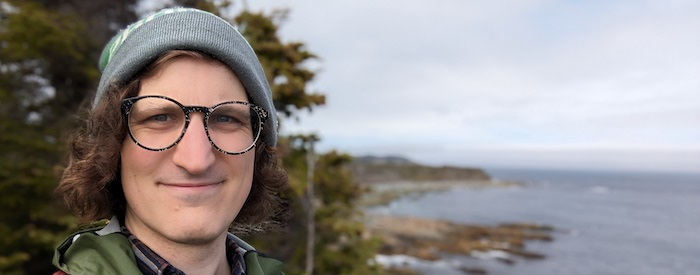

:robot: I'm a Researcher and Engineer with 10+ years experience in Robotics, Computer Vision and Machine Learning. I earned my PhD at the  University of Toronto.

:eye: I'm currently building Vison AI as a Machine Learning Engineer at [Roboflow](https://roboflow.com). Previously I worked on Autonomous Vehicles at [Oxa](https://oxa.tech).

:round_pushpin: I'm based in St. John's, Newfoundland and Labrador, Canada.